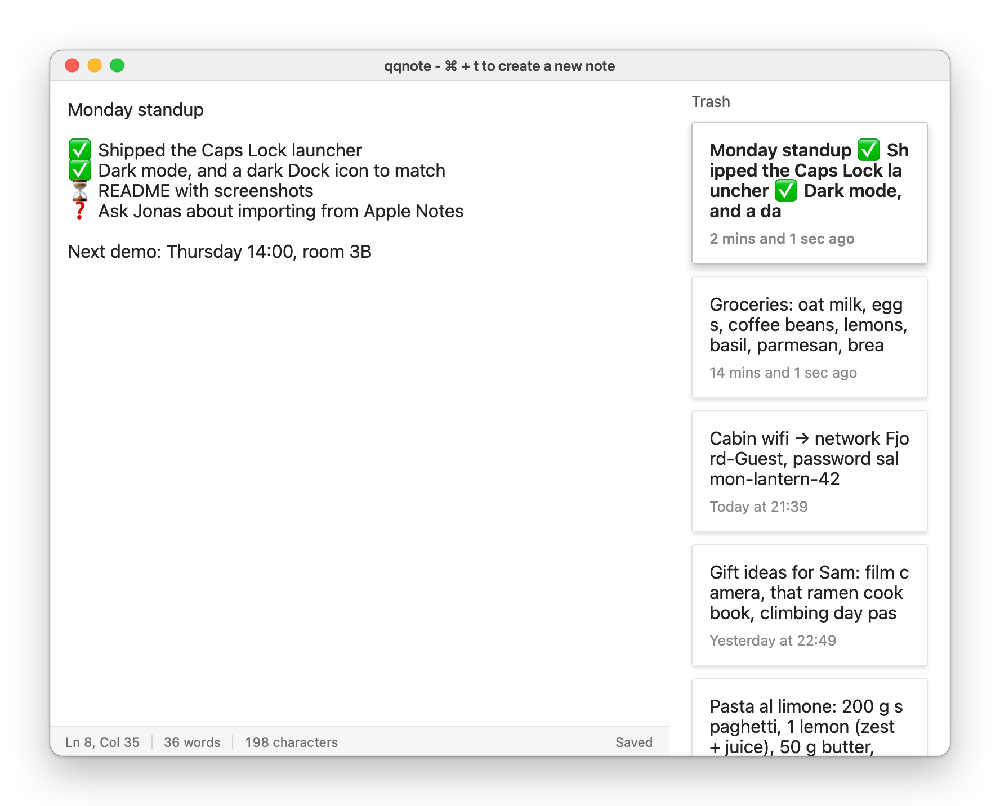
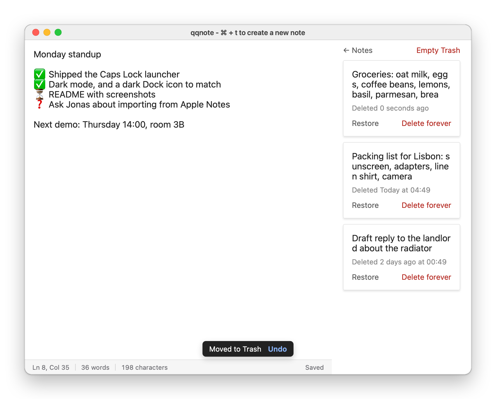
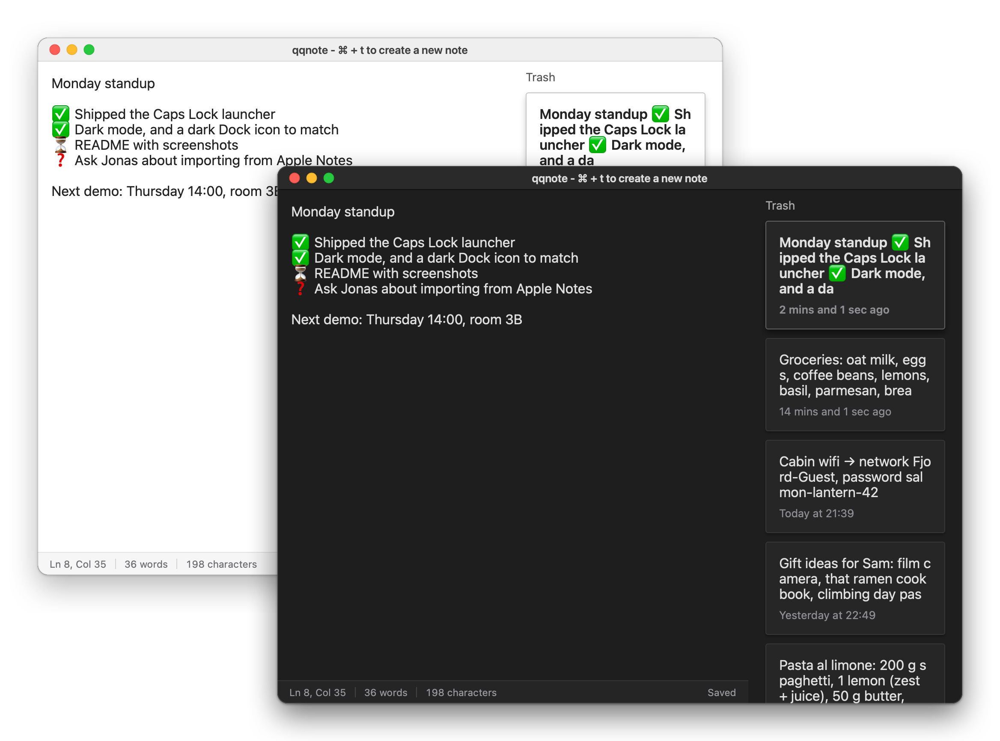

<div align="center">

  <picture>
    <source media="(prefers-color-scheme: dark)" srcset="src-tauri/icons/icon-dark.png">
    
  </picture>

  <h1>qqnote</h1>

  <p><strong>The fastest way to create a note (in the wild west).</strong></p>

  <p>
    Press <kbd>Caps Lock</kbd> anywhere on your Mac, type, press it again, and you're back to work.<br>
    Every keystroke is saved. No folders, no formatting, no Save dialog.
  </p>

</div>

<br>

<p align="center">
  <a href="docs/qqnote-launch.mp4">
    
  </a>
  <br>
  <sub>Sound off. <a href="docs/qqnote-launch.mp4">Watch the MP4 with sound.</a></sub>
</p>

<picture>
  <source media="(prefers-color-scheme: dark)" srcset="docs/screenshots/hero-dark.png">
  
</picture>

## Features

### ⇪ Caps Lock opens qqnote from anywhere

Press <kbd>Caps Lock</kbd> in any app and qqnote jumps to the front. Press it again and you're right back where you were.

- **Nothing else to install.** No Hyperkey, Karabiner or Raycast, and no Accessibility permission to grant.
- **Caps Lock comes back** as soon as qqnote quits.
- **Always ready.** Closing the window keeps qqnote running in the background, so the key always works. Turn on **qqnote ▸ Open at Login** and it's there after a restart too.

### 💾 You won't lose a word

- **Saves as you type:** 0.3 seconds after you pause, at least every 3 seconds while you keep going, whenever you switch to another app, and before opening another note or quitting.
- **You always know where you stand.** The status bar says **Edited** or **Saved**. If a save ever fails, it says so in red and keeps retrying.
- **Deleting is undoable.** A deleted note goes to the Trash with an **Undo** button. Restore it later, or delete it forever when you're sure.

<picture>
  <source media="(prefers-color-scheme: dark)" srcset="docs/screenshots/trash-dark.png">
  
</picture>

### 🗂️ Everything one shortcut away

- <kbd>⌘</kbd> <kbd>B</kbd> lists every note, most recently edited first. Click one to open it.
- A Notepad-style status bar shows line and column, words and characters (an emoji counts as one). Select some text and it shows "3 of 36 words".
- Plain text stays plain: no autocorrect, smart quotes or dash rewriting, and <kbd>Tab</kbd> types a real tab you can undo.

### 🌗 Light, dark, or whatever your Mac is doing

qqnote follows your Mac's appearance, or you can pick one under **View ▸ Appearance**. In dark mode, even the Dock icon goes dark.

<p align="center">
  
  &nbsp;&nbsp;
  
</p>



### 🔒 Your notes stay on your Mac

Notes live in a SQLite database at `~/.qqnote/app_data.db`. There's no account, no cloud and no tracking. The only time qqnote goes online is to check GitHub for a new version of itself. **qqnote ▸ Export Notes** saves every note to a JSON file, and **Import Notes** brings them back with their dates. Before qqnote upgrades its database, it writes a backup to `~/.qqnote/backups`.

### 🔄 Keeps itself up to date

qqnote checks for a new version when it starts and every few hours, and installs it in the background. When it's ready, **Restart to update** appears in the status bar and the qqnote menu; your note is saved before the restart. If you'd rather not restart, you get the new version the next time qqnote starts. **qqnote ▸ Check for Updates…** checks right away.

### 🪶 Tiny

The download is 7.5 MB, for one app that runs on both Apple silicon and Intel, because it's built with [Tauri](https://tauri.app) instead of shipping a browser.

## Keyboard shortcuts

| Shortcut | What it does |
| --- | --- |
| <kbd>Caps Lock</kbd> | Show or hide qqnote, from any app |
| <kbd>⌘</kbd> <kbd>T</kbd> | New note |
| <kbd>⌘</kbd> <kbd>B</kbd> | Show or hide all notes |
| <kbd>⌘</kbd> <kbd>S</kbd> | Save now (it saves on its own anyway) |
| <kbd>⌘</kbd> <kbd>W</kbd> | Close the window; qqnote keeps running |
| <kbd>⌘</kbd> <kbd>Q</kbd> | Save and quit |

## Install

[**Download qqnote**](https://github.com/qwertyu-alex/qqnote/releases/latest/download/qqnote.dmg), open it and drag qqnote into Applications. It runs on Macs with Apple silicon or Intel. It's signed and notarized by Apple, so macOS only asks the usual "downloaded from the Internet" question the first time you open it.

### Build it yourself

You need macOS with the Xcode Command Line Tools (`xcode-select --install`), [Rust](https://rustup.rs), [Node.js](https://nodejs.org) 20.19 or newer, and [pnpm](https://pnpm.io) (`corepack enable` sets it up).

```sh
git clone https://github.com/qwertyu-alex/qqnote.git
cd qqnote
pnpm install
pnpm tauri build --bundles app
cp -R src-tauri/target/release/bundle/macos/qqnote.app /Applications/
```

rustup installs the right Rust version by itself; it's pinned in `src-tauri/rust-toolchain.toml`. A copy you build updates itself to the official releases, like a downloaded one.

> [!NOTE]
> If you already remap Caps Lock with Hyperkey or Karabiner, or bound F13 in Raycast, turn that off so qqnote gets the key.

## Development

```sh
pnpm tauri dev
```

Dev builds use their own database (`~/.qqnote/dev_app_data.db`), so experimenting can't touch your real notes.

The icon's source is `app-icon.png`. After changing it, regenerate the app icons and the dark Dock icon:

```sh
pnpm tauri icon app-icon.png
swift scripts/make-dark-icon.swift app-icon.png src-tauri/icons/icon-dark.png
```

### How the Caps Lock trick works

macOS doesn't let apps use Caps Lock as a shortcut. So while qqnote runs, it remaps Caps Lock to F13 on every keyboard, using the same `UserKeyMapping` setting that System Settings uses for modifier keys. It then registers F13 as a global hotkey. Neither step needs a permission prompt. The remap is reapplied when you plug in a keyboard and removed when qqnote quits. The code is in [`src-tauri/src/launcher.rs`](src-tauri/src/launcher.rs).

## Releasing

Releases are made on a Mac that has the Developer ID certificate in its keychain:

```sh
pnpm release 0.2.0
```

That sets the version and commits it, builds one app for Apple silicon and Intel, signs it, and has Apple notarize the app and the disk image. After you confirm, it tags the commit and publishes a GitHub release with `qqnote.dmg`, the update, and `latest.json`, which is where running copies of qqnote look for new versions.

It needs, once:

1. **Notarization credentials.** Make an app-specific password at [account.apple.com](https://account.apple.com) (Sign-In and Security ▸ App-Specific Passwords), then save it for notarytool, which asks for it:

   ```sh
   xcrun notarytool store-credentials qqnote --apple-id <your Apple ID> --team-id Y566K9WVAD
   ```

2. **The update signing key**, at `~/.tauri/qqnote.key`, with its password in the login keychain under `qqnote-updater-key`. qqnote only installs updates signed with this key, so back up both, for example in a password manager: if they're lost, installed copies can't update anymore. `security find-generic-password -s qqnote-updater-key -w` shows the password.

## Built with

[Tauri 2](https://tauri.app) · Rust · SQLite via [Diesel](https://diesel.rs) · [Preact](https://preactjs.com) · TypeScript · [Vite](https://vite.dev)
